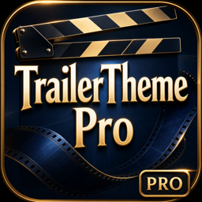
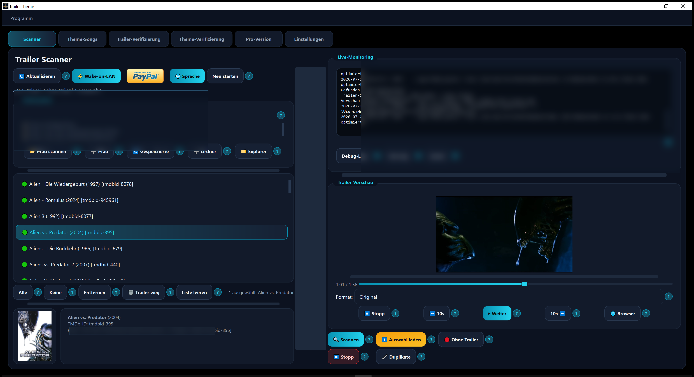
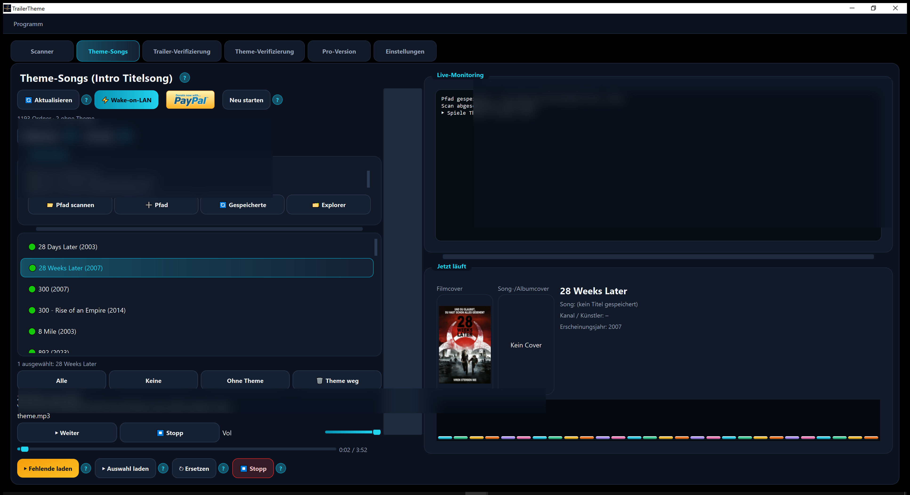
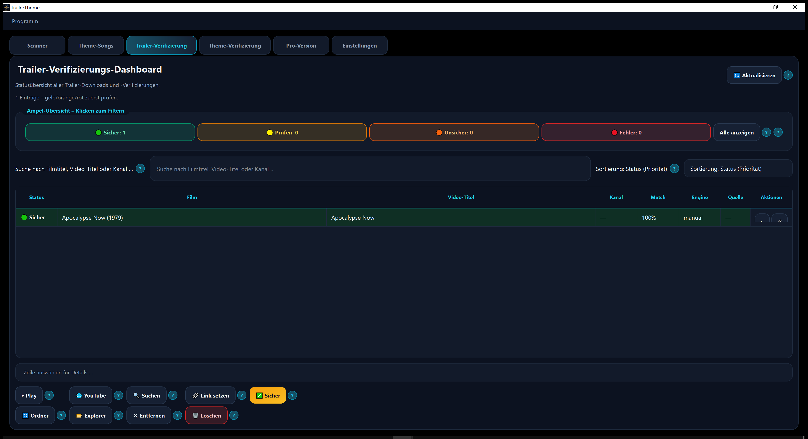
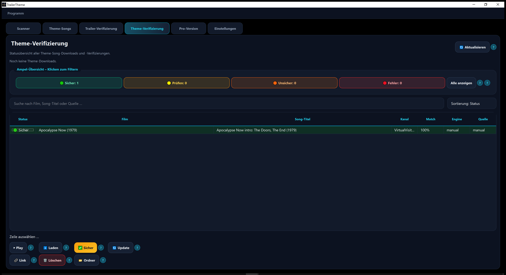
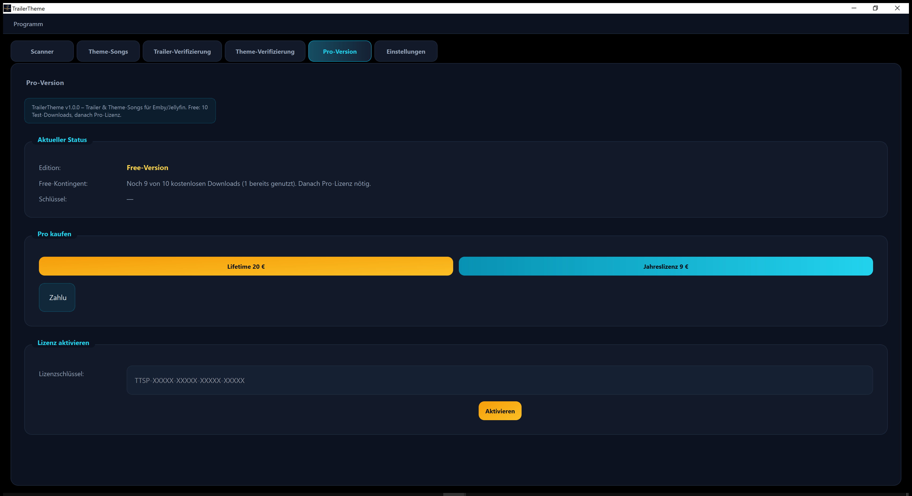
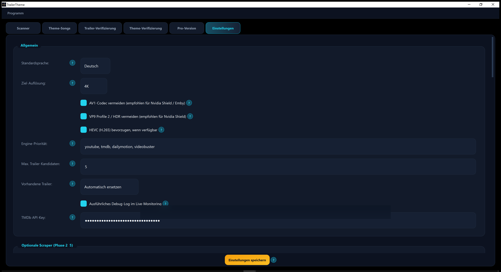

# TrailerTheme – Trailer & Theme Song Downloader for Emby/Jellyfin/Plex

  

  
  &nbsp;&nbsp;
  

**Trailer & Theme-Songs for Emby / Jellyfin / Plex** — free Windows app (open source, MIT).  
**Trailer & Theme-Songs für Emby / Jellyfin / Plex** — kostenlose Windows-App (Open Source, MIT).

**No license key. No trial limit. All features unlocked.**  
**Kein Lizenzschlüssel. Kein Testkontingent. Alle Funktionen freigeschaltet.**

This repository publishes **installers and product screenshots**.  
Dieses Repository enthält **Installer und Produktbilder**.

Optional: support development with a PayPal donation (in-app **Support** tab).  
Optional: Entwicklung per PayPal-Spende unterstützen (Tab **Support** in der App).

---

## Download

Latest release: **[v1.1.0](https://github.com/Gembird79/TrailerTheme-Trailer-and-Theme-Song-Downloader-for-Emby-Jellyfin-Plex-for-Windows/releases/tag/v1.1.0)**

All versions: **[Releases / Downloads](https://github.com/Gembird79/TrailerTheme-Trailer-and-Theme-Song-Downloader-for-Emby-Jellyfin-Plex-for-Windows/releases)**

Windows installer example: `TrailerTheme-Setup-1.1.0-win64.exe`

In-app updates check this repository automatically.

---

## What’s new in 1.1.0 / Neu in 1.1.0

| EN | DE |
|----|----|
| Open source / full version – no license key | Open Source / Vollversion – kein Lizenzschlüssel |
| **Support** tab with optional PayPal donation | Tab **Support** mit optionaler PayPal-Spende |
| TMDB ID resolve by title+year (no more `/movie/0`) | TMDB-ID per Titel+Jahr (kein `/movie/0` mehr) |
| Optional Emby `ProviderIds.Tmdb` lookup | Optional Emby-Lookup über `ProviderIds.Tmdb` |

---

## Features / Funktionen

| EN | DE |
|----|----|
| **Scanner** — scan movie/series folders, find & download trailers | **Scanner** — Medienordner scannen, Trailer finden und herunterladen |
| **Theme Songs** — find intro/title themes as MP3 | **Theme-Songs** — Intro-/Titelsongs als MP3 speichern |
| **Verification** — review downloads, confirm or replace | **Verifizierung** — Downloads prüfen, bestätigen oder ersetzen |
| **Support** — optional PayPal donation (fully free to use) | **Support** — optionale PayPal-Spende (App kostenlos nutzbar) |
| **Settings** — language, quality, browser cookies, helper updates | **Einstellungen** — Sprache, Qualität, Browser/Cookies, Updates |

---

## Screenshots / Einblicke

### Scanner
Scan your library, pick titles, preview trailers with cover art.  
Medienbibliothek scannen, Titel wählen, Trailer mit Cover vorschauen.

### Theme Songs / Theme-Songs
Find and play intro themes; save as `theme.mp3` for Emby/Jellyfin.  
Intro-Themes finden und abspielen; als `theme.mp3` speichern.

### Trailer verification / Trailer-Verifizierung
Traffic-light status for downloaded trailers; confirm safe matches.  
Ampel-Status für heruntergeladene Trailer; sichere Treffer bestätigen.

### Theme verification / Theme-Verifizierung
Same verification flow for theme songs.  
Gleiche Verifizierung für Theme-Songs.

### Support / Spenden
Optional donation via PayPal – all features are unlocked.  
Optionale PayPal-Spende – alle Funktionen sind freigeschaltet.

### Settings / Einstellungen
Language, resolution, Shield-friendly codecs, TMDb and more.  
Sprache, Auflösung, Shield-taugliche Codecs, TMDb und mehr.

  
   
  Windows installer / EXE icon

---

## License / Lizenz

**MIT** — free to use, share, and modify.  
**MIT** — frei nutzbar, teilbar und änderbar.

---

## Support / Hilfe

Bugs or questions? Please open an **[Issue](https://github.com/Gembird79/TrailerTheme-Trailer-and-Theme-Song-Downloader-for-Emby-Jellyfin-Plex-for-Windows/issues)**.  
Fehler oder Fragen? Bitte ein **[Issue](https://github.com/Gembird79/TrailerTheme-Trailer-and-Theme-Song-Downloader-for-Emby-Jellyfin-Plex-for-Windows/issues)** erstellen.
